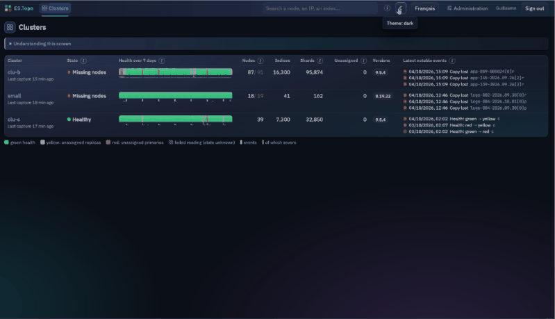

*(English version: [README.md](README.md))*

# ES.Topo

[](https://github.com/gnocent/estopology/actions/workflows/check.yml)
[](https://github.com/gnocent/estopology/releases)
[](LICENSE)

ES.Topo garde l'historique de la **topologie** de vos clusters Elasticsearch (7.17 à 9.x) et permet de l'explorer dans le temps. Où étaient les shards à 3 h 12 ? Quels nœuds sont partis, et avec quelles copies ? Qu'est-ce qui a bougé entre hier et maintenant, allers-retours compris ? Un seul binaire, sans dépendance, collecte en lecture seule, range l'historique dans des fichiers SQLite et sert une interface web entièrement embarquée : il fonctionne aussi sur un réseau sans accès à Internet.

> **Version 0.8.1-beta.** Le produit a été testé contre de vrais clusters Elasticsearch 7.17, 8.19 et 9.5 de test et sur des données simulées, pas encore en production à grande échelle. Attendez-vous à des défauts, lisez les [limites connues](CHANGELOG_fr.md#limites-connues) et ne l'exposez pas sur un réseau sans avoir lu [SECURITY_fr.md](SECURITY_fr.md). Le format des données et l'API peuvent encore changer avant la version 1.0.



*Un incident rejoué sur des données simulées : on recule dans le temps, on descend jusqu'au nœud, puis on compare deux dates.*

## Pourquoi

Pendant un incident (nœuds perdus, shards non assignés, rééquilibrage massif, mise à jour qui se passe mal), Elasticsearch montre l'état **présent**. Les outils de supervision donnent des métriques, pas la topologie. ES.Topo répond aux questions sur le **passé** :

- où se trouvait chaque copie de shard à une date donnée, et sur quels nœuds, machines et zones ;
- quels nœuds existaient, avec quels rôles, attributs et versions, et quand cela a changé ;
- ce qui a changé entre deux dates, y compris ce qui est revenu à son point de départ ;
- quelles copies ont été perdues avec un nœud ou une machine, et ce qu'elles sont devenues.

ES.Topo ne modifie jamais un cluster : son client n'émet que des requêtes de lecture.

## Fonctionnalités

- **Collecte adaptative, en lecture seule** : une sonde légère toutes les 5 minutes ; une capture complète quand quelque chose change (santé, nœuds, shards en mouvement, cluster settings), au plus toutes les 10 minutes et au moins toutes les heures. Ces durées se règlent par cluster.
- **Bandeau temporel** sur toutes les vues datées : frise de santé, densité d'événements et curseur. La date est dans l'adresse de la page : chaque vue est un permalien.
- **Vue physique** : les nœuds rangés par zone, tier et machine, colorés au choix (état des shards, disque, CPU, heap, nombre de shards, version). Une page par zone, tier, machine et nœud, avec un bouton « Zoom arrière » et un fil d'Ariane.
- **Vue logique** : matrice des copies de shards, une ligne par famille d'indices ou par index, une colonne par nœud ou par zone, tier ou machine ; filtre sur les noms.
- **Diff entre deux dates** et **chemin parcouru**, qui montre aussi les allers-retours invisibles dans une comparaison.
- **Pertes** : copies disparues avec leur nœud ou leur machine, et ce qu'elles sont devenues (réplica promu, réallocation, copie toujours non assignée).
- **Journal d'événements**, avec la fenêtre d'incertitude de chaque changement, ou la date exacte quand Elasticsearch la fournit.
- **Flux de déplacements** (diagramme de Sankey) et trajectoire d'un shard.
- **Contraintes d'allocation** : index dont les règles ne laissent pas, ou presque pas, assez de nœuds.
- **Graphiques** par famille d'indices, par index, par nœud et par groupe de nœuds.
- **Recherche** d'un nœud, d'une adresse IP, d'une machine, d'un index, d'une famille ou d'un shard précis ; **exports** CSV, JSON et XLSX.
- Interface en français et en anglais, thème clair ou sombre, aide dans chaque écran (« Comprendre cet écran »).
- **Authentification** : aucune, comptes locaux ou annuaire LDAP (OpenLDAP) ; rôles lecteur et admin.
- **Haute disponibilité** : une instance standby passive, promue à la main.
- **Exploitation** : rétention par durée et par taille, `/healthz`, `/metrics` (Prometheus, à activer), journal d'audit.
- **Simulateur** `essim` pour essayer le produit sans cluster réel.

## Prérequis

- **Pour l'exécuter : rien à installer.** Le binaire est statique ; l'interface, les polices et le moteur de base de données sont dedans.
- **Plateformes** : Linux x86-64 pour la production (démarrage testé sur AlmaLinux et Rocky Linux 8, 9 et 10). Des binaires Windows x64 et macOS arm64 (Apple Silicon) sont fournis pour l'essai et le développement.
- **Elasticsearch** : 7.17, 8.x et 9.x. Les réponses des versions 7.17.29, 8.19.22 et 9.5.4 sont testées à partir de captures de vrais clusters.
- **Navigateur** : une version récente de Chrome, Edge ou Firefox.

## Démarrage rapide (5 minutes)

Les commandes sont pour Linux. Pour Windows et macOS, voir le [guide d'installation](docs/installation_fr.md).

1. **Téléchargez** `estopo-linux-amd64` et `SHA256SUMS` depuis la [page des versions](../../releases).
2. **Vérifiez** le fichier, puis rendez-le exécutable :

   ```bash
   sha256sum -c SHA256SUMS --ignore-missing
   chmod +x estopo-linux-amd64
   ```

   La première commande doit afficher `estopo-linux-amd64: OK`.
3. **Lancez-le.** Sans réglage, il écoute sur `127.0.0.1:8080` (cette machine seulement) et crée un dossier `data` à côté du binaire :

   ```bash
   ./estopo-linux-amd64 serve
   ```

4. **Ouvrez** `http://127.0.0.1:8080`. Un bandeau rappelle que l'authentification est désactivée : tant que l'écoute reste locale et que la machine n'est utilisée que par vous, c'est acceptable pour un essai.
5. **Ajoutez un cluster** : **Administration › Clusters**, « Nouveau cluster », puis « Tester la connexion » et « Enregistrer ». Le guide [Déclarer un cluster](docs/clusters_fr.md) explique le compte à créer côté Elasticsearch et chaque champ du formulaire. La première capture arrive en moins d'une minute.

Pour une installation durable (service systemd, HTTPS, authentification), suivez le [guide d'installation](docs/installation_fr.md).

### Essayer avec des données simulées

`essim`, livré avec `estopo`, fabrique un historique de 14 jours contenant des incidents (nœuds et machine perdus, mise à jour progressive, datacenter perdu…) :

```bash
chmod +x essim-linux-amd64
./essim-linux-amd64 backfill -data /tmp/estopo-demo -clusters c,small
ESTOPO_DATA_DIR=/tmp/estopo-demo ./estopo-linux-amd64 serve
```

Ouvrez ensuite `http://127.0.0.1:8080`. L’option `-clusters c,small` limite l’essai à deux petits clusters ; sans elle, la fabrication ajoute un cluster de 91 nœuds et dure environ une demi-heure. Les autres usages du simulateur (clusters simulés en direct, incidents provoqués à la main, scénarios) sont décrits dans le [guide d'exploitation](docs/operations_fr.md#simulateur-et-données-de-démonstration).

## Documentation

| Document | Pour qui | Autre langue |
|---|---|---|
| [Installation](docs/installation_fr.md) | toute personne qui installe ES.Topo : binaire, service, HTTPS, premier démarrage | [English](docs/installation.md) |
| [Déclarer un cluster](docs/clusters_fr.md) | l'administrateur Elasticsearch : compte en lecture seule, formulaire, planification, familles | [English](docs/clusters.md) |
| [Authentification](docs/authentication_fr.md) (avancé) | qui ouvre l'accès à plusieurs personnes : comptes locaux, LDAP, sessions | [English](docs/authentication.md) |
| [Haute disponibilité](docs/high-availability_fr.md) (avancé) | qui veut une seconde instance prête à prendre le relais | [English](docs/high-availability.md) |
| [Exploitation](docs/operations_fr.md) | qui fait tourner le service : stockage, sauvegarde, supervision, simulateur | [English](docs/operations.md) |
| [Sécurité](SECURITY_fr.md) | tout le monde, avant d'exposer le service | [English](SECURITY.md) |
| [Journal des versions](CHANGELOG_fr.md) | contenu de chaque version, limites connues | [English](CHANGELOG.md) |
| [Spécification](SPEC_fr.md) | qui veut comprendre la conception en détail ou contribuer | [English](SPEC.md) |

## Sécurité en bref

- ES.Topo ne fait que **lire** les clusters Elasticsearch.
- Par défaut, il n'écoute que sur `127.0.0.1` et **n'a pas d'authentification** : tout visiteur est administrateur. Activez l'authentification **avant** de l'exposer sur le réseau.
- L'authentification (comptes locaux ou LDAP) est refusée sur une écoute HTTP non locale : il faut HTTPS.
- Les mots de passe, clés et jetons ne sont jamais saisis dans l'interface : on y indique le **chemin d'un fichier**.
- Les requêtes de modification qui viennent d'un autre site web sont refusées.

Le modèle de sécurité, la liste de durcissement, les limites connues et la façon de signaler une vulnérabilité sont dans [SECURITY_fr.md](SECURITY_fr.md).

## Compiler et développer

Il faut Go (la version indiquée dans `go.mod`) et, seulement pour modifier l'interface, Node.js 20 avec npm. L'interface compilée (`web/dist`) est versionnée : `go build ./cmd/estopo` suffit pour obtenir un binaire.

```bash
./scripts/check.sh               # gofmt, vet, tests, compilation pour Linux, Windows et macOS
UI_CHECK=1 ./scripts/check.sh    # en plus : vérification des types et compilation de l'interface
RACE=1 ./scripts/check.sh        # en plus : détecteur d'accès concurrents (demande gcc)
./build-release.sh               # binaires de version dans dist/
cd web && npm ci --ignore-scripts && npm run build   # recompiler l'interface
cd web && npm run test:e2e       # tests Playwright de l'interface, contre essim et estopo
```

`build-release.sh` produit `dist/linux-amd64/`, `dist/windows-amd64/` et `dist/macos-arm64/` (binaires `estopo` et `essim`, licence, notices, sommes SHA-256), ainsi que `dist/release/`, qui contient les fichiers publiés : `estopo-linux-amd64`, `estopo-windows-amd64.exe`, `estopo-macos-arm64`, les mêmes pour `essim`, `SHA256SUMS`, `LICENSE` et `THIRD_PARTY_NOTICES.md`.

Environnements de test, qui demandent Docker :

- `scripts/capture-fixtures.sh <version>` : démarre un vrai cluster Elasticsearch sécurisé, capture ses réponses et teste le client avec les trois authentifications ;
- `testenv/ldap/run.sh` : teste l'authentification contre un vrai OpenLDAP, en LDAPS et en StartTLS ;
- `testenv/distros/run.sh` : démarre le binaire sur AlmaLinux et Rocky Linux 8, 9 et 10.

Deux automatisations GitHub existent. À chaque envoi sur la branche principale et à chaque demande de fusion, `scripts/check.sh` est exécuté et l'on vérifie que `web/dist` correspond aux sources. À chaque étiquette `v*`, les binaires sont compilés et publiés.

## Organisation du dépôt

```
cmd/estopo/    binaire principal (serve, version, admin reset-password)
cmd/essim/     simulateur de clusters Elasticsearch
internal/      collecte, stockage, requêtes, API, authentification, haute disponibilité, simulation
web/           sources de l'interface (Svelte) ; web/dist est la version compilée, embarquée dans le binaire
deploy/        exemple d'unité systemd et de fichier d'environnement
docs/          guides
scripts/       vérification, capture de réponses réelles, notices de licences
testenv/       environnements de test (Elasticsearch, OpenLDAP, distributions Linux)
testdata/      réponses de vrais clusters Elasticsearch 7.17, 8.19 et 9.5
```

## Licence

ES.Topo est distribué sous licence [GNU Affero General Public License v3](LICENSE) (AGPL-3.0). Les licences des bibliothèques et des polices incluses dans les binaires sont reproduites dans [THIRD_PARTY_NOTICES.md](THIRD_PARTY_NOTICES.md), fourni avec chaque version.

## Absence de garantie

Ce logiciel est fourni « en l'état », sans garantie d'aucune sorte, comme le précisent les articles 15 et 16 de la licence. C'est une version bêta : essayez-la d'abord sur un environnement de test, sauvegardez son dossier de données et vérifiez par vous-même ce qu'elle affiche avant de vous en servir pour décider d'une action sur un cluster. ES.Topo est un projet indépendant, sans lien avec Elastic N.V. ; Elasticsearch est une marque de son propriétaire.
